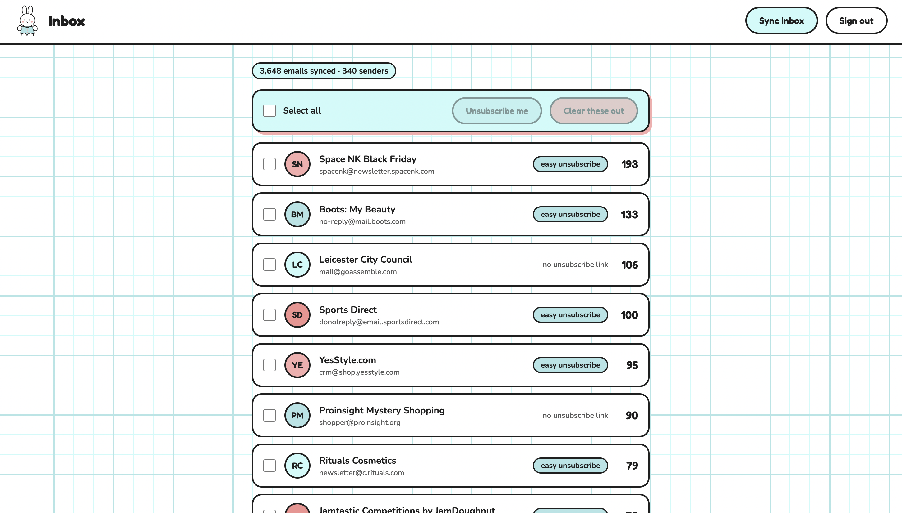
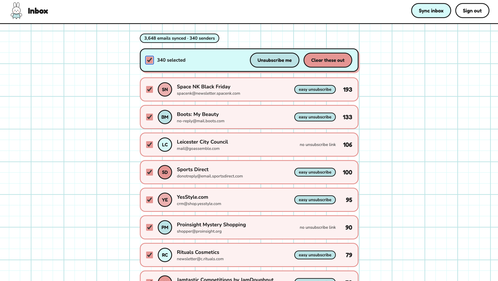

# Bulk Email Cleaner

A web app that helps you clean up your Gmail inbox in bulk. It groups your emails by sender so you can see who fills your inbox, then lets you unsubscribe from senders or send all of their emails to the bin in one click.

<p>
  
  
</p>

## Features

- **Sign in with Google.** Uses Google OAuth, so the app never sees your password.
- **Sync your inbox.** Pulls the latest emails (up to 2,000 per sync) and stores only their details: sender, subject, date and unsubscribe info. It doesn't store the email bodies.
- **See senders, not individual emails.** Emails are grouped by sender with a count, so the biggest offenders are at the top.
- **One-click unsubscribe.** For senders that provide an unsubscribe link, the app follows it for you, or sends the unsubscribe email if that's what the sender asks for.
- **Bulk clear out.** Select one or many senders and move all of their emails to your Gmail bin.


## Tech stack

| Part | Built with |
| --- | --- |
| Frontend | React 19, TypeScript, Vite, Tailwind CSS 4 |
| Backend | Python, FastAPI, SQLAlchemy |
| Database | PostgreSQL |
| Email access | Gmail API with Google OAuth 2.0 |

## Getting started

You will need:

- [Node.js](https://nodejs.org) (v20 or newer)
- [Python](https://www.python.org) 3.10 or newer
- [PostgreSQL](https://www.postgresql.org) running locally
- A Google account and a free Google Cloud project

### 1. Set up Google sign-in

1. Go to the [Google Cloud Console](https://console.cloud.google.com) and create a project.
2. Under **APIs & Services → Library**, search for **Gmail API** and enable it.
3. Under **Google Auth Platform** (or **OAuth consent screen**), set up the consent screen. Choose **External**, and add your own Gmail address as a **test user**.
4. Under **Data Access** (or **Scopes**), add this scope: `https://www.googleapis.com/auth/gmail.modify`
5. Under **Credentials**, create an **OAuth client ID** of type **Web application**. Add this as an authorised redirect URI:
   ```
   http://localhost:8000/auth/google/callback
   ```
6. Copy the **client ID** and **client secret**. You'll need them in the next step.

### 2. Set up the database

Make sure PostgreSQL is running, then create the database:

```bash
createdb smart_email_assistant
```

The app creates its tables automatically the first time it starts.

### 3. Run the backend

```bash
cd backend
python3 -m venv venv
source venv/bin/activate          # on Windows: venv\Scripts\activate
pip install -r requirements.txt
cp .env.example .env
```

Open `backend/.env` and fill in your values:

| Variable | What it is |
| --- | --- |
| `GOOGLE_CLIENT_ID` | From step 1 |
| `GOOGLE_CLIENT_SECRET` | From step 1 |
| `GOOGLE_REDIRECT_URI` | `http://localhost:8000/auth/google/callback` |
| `DATABASE_URL` | For example `postgresql+psycopg2://YOUR_USERNAME@localhost/smart_email_assistant` |
| `JWT_SECRET` | Any long random string. Generate one with `python3 -c "import secrets; print(secrets.token_urlsafe(32))"` |

Then start the server:

```bash
uvicorn main:app --reload --port 8000
```

Check it's running at <http://localhost:8000/health>.

### 4. Run the frontend

In a second terminal:

```bash
cd frontend
npm install
npm run dev
```

Open <http://localhost:5173>, sign in with Google, press **Sync inbox**, and you're ready to go.

## How it works

1. **Login.** The frontend sends you to the backend, which sends you to Google. After you approve, the backend creates or finds your user and gives the frontend a login token (a JWT).
2. **Sync.** The backend reads your inbox from the Gmail API and saves each email's details in PostgreSQL.
3. **Group.** The inbox page asks the backend for your emails grouped by sender.
4. **Act.** "Unsubscribe me" follows each sender's `List-Unsubscribe` header. "Clear these out" moves those emails to the Gmail bin and marks them as cleared in the database.

## Good to know

- **Clearing is recoverable.** Emails go to your Gmail bin, not permanently deleted. Gmail empties the bin automatically after 30 days.
- **Unsubscribing isn't guaranteed.** The app does what an email client would do, but it's up to each sender to honour the request. Some senders need you to confirm on a web page, and those will show as failed. Senders with no unsubscribe header show "no unsubscribe link".
- **Large actions take time.** Syncing or clearing many emails makes many Gmail requests, so the buttons can stay greyed out for a while.
- **Test mode.** While your Google app is in "Testing" mode, only the test users you added can sign in.
- **Keep your secrets private.** Never commit your `.env` file. It's already listed in `.gitignore`.

## Project structure

```
backend/
  main.py                  App setup, CORS and routes
  app/
    routers/               /auth and /emails endpoints
    services/              Gmail logic (sync, trash, unsubscribe)
    models/                Database tables
frontend/
  src/
    pages/                 Login and Inbox pages
    components/            Sender rows, bunny mascot, header, hearts
    context/               Login state
    api/                   Backend API client
```
